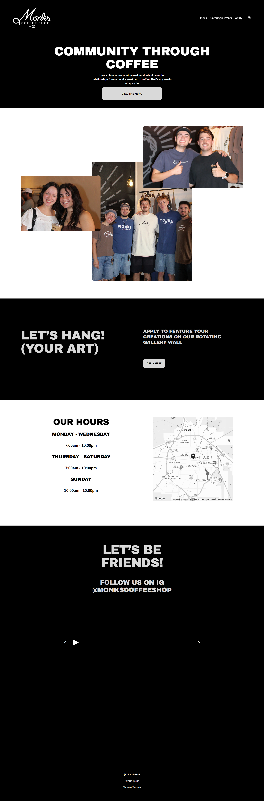
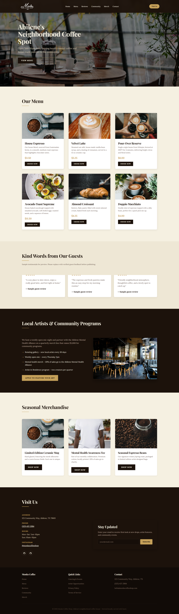
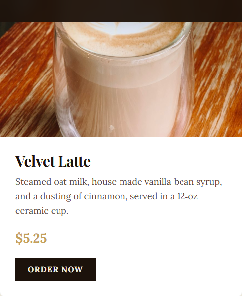
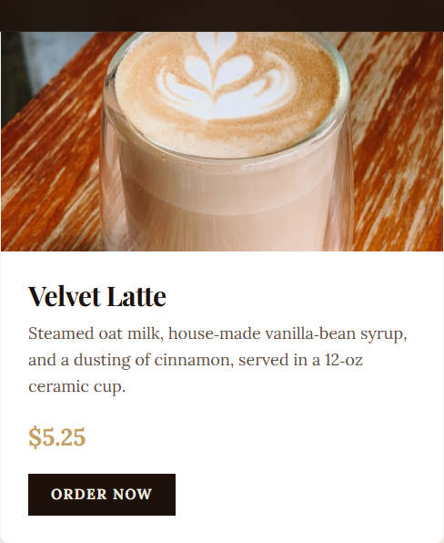
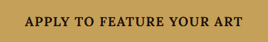

# Monks Coffee Shop — Website Portfolio Project

A responsive, performance-minded website concept for Monks Coffee Shop in Abilene, Texas. This repository documents the current public-site reference, the redesign preview, and the front-end improvements in one place.

> **Project status:** static front-end portfolio/demo. This repository is not a live reservation service. The reservation form is an interactive prototype; it does not send or store visitor details, check table availability, or confirm bookings.

## Reference and redesign preview

The left image is the supplied screenshot of the existing site. The right image is the supplied full-page preview of this project. They are shown as reference and concept—not as an exact, matched before/after test.

<p align="center">
  
  
</p>

## Selected UI improvements

These focused screenshots show the menu-photo crop and contrast update made during this project.

| Before | After |
| --- | --- |
| **Velvet Latte** — [full image](screenshots/before-menu.png) | **Velvet Latte** — [full image](screenshots/after-menu.png) |
|  |  |
| **Artist CTA** — [full image](screenshots/before-community.png) | **Artist CTA** — [full image](screenshots/after-community.png) |
|  |  |

## What this project demonstrates

- **Conversion-focused layout:** a prominent reservation call to action, a menu call to action, scannable menu cards with prices, and direct order links.
- **Reservation-flow prototype:** an accessible demo form with name, email, date, time, party size, browser validation, and a clear notice that nothing is booked or transmitted.
- **Performance-minded delivery:** self-hosted WOFF2 fonts instead of a runtime Google Fonts stylesheet, local image assets, a high-priority hero-image preload, lazy-loaded below-the-fold images, and image dimensions to reduce layout shifts.
- **Responsive experience:** layouts and navigation sized for desktop and mobile, including a keyboard-operable mobile menu with accessible expanded-state labels.
- **Brand and content presentation:** the supplied Monks logo, coffee photography, menu, community section, merchandise, and a sample testimonials layout.

These are implementation choices, not a claim of a measured Lighthouse score, increased conversions, or production booking capability. The testimonials are labeled as samples and should be replaced with approved, genuine reviews before launch.

## Run locally

This is a static site with no build step or package installation required:

```powershell
python -m http.server 8000
```

Then open <http://localhost:8000/>.

## Production follow-up

Before treating this concept as a live business website, confirm the business-approved menu, prices, contact details, hours, and reviews; connect the reservation flow to the café's selected booking system; and run performance and accessibility checks against the deployed site. The demo form intentionally does not imply that a reservation has been received or confirmed.

## Technology

HTML · CSS · vanilla JavaScript · locally hosted image and WOFF2 assets
